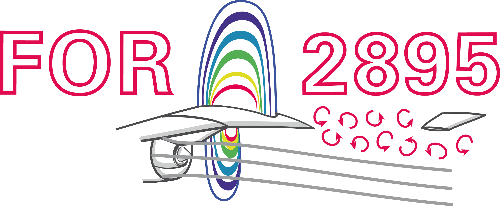

<p align="center">
  <a href="https://www.for2895.uni-stuttgart.de/">
    
  </a>
</p>

# XRF1 upper-wing surface analysis

**Reproducible workflows accompanying a collaborative research article.**

This repository provides the data preparation and analysis workflows for the XRF1 upper-wing surface study within [FOR 2895](https://www.for2895.uni-stuttgart.de/), a research unit investigating unsteady flow and interaction phenomena at high-speed stall conditions.

The article is a collaborative effort between the [**Institute of Aerodynamics and Gas Dynamics**](https://www.iag.uni-stuttgart.de/en/), University of Stuttgart, and the [**Institute of Fluid Mechanics**](https://tu-dresden.de/ing/maschinenwesen/ism), TU Dresden.

[Reproducibility](#reproducibility) · [Publications and archive](#publications-and-archive) · [Acknowledgements](#acknowledgements)

## Reproducibility

Use Python 3.14.6, LaTeX, and FFmpeg. Run from the repository root.

```bash
python3.14 -m venv .venv
source .venv/bin/activate
python -m pip install torch==2.15.0+cpu --index-url https://download.pytorch.org/whl/cpu
python -m pip install -r requirements-lock.txt
cp .env.example .env
```

Set `PLT_DATA_DIR`, `PSP_DATA_DIR`, and `OUTPUT_DIR` in `.env`. Use an empty output directory for a full rebuild. With the saved analysis results, start at **Reproduce figures**.

### Prepare data and compute SPOD

```bash
python scripts/convert_surface.py --zones wing-upper --fields cp cfx cfy cfz
python scripts/svd_study.py full --case cp
python scripts/psp_study.py full --polar 0257 --polar 0258 --polar 0259 --polar 0260 --polar 0261
python scripts/psp_svd.py full
for polar in 0257 0258 0259 0260 0261; do
    python scripts/psp_spod.py --polar "$polar"
done
for polar in 0258 0261; do
    for rank in 400 800; do
        python scripts/psp_spod.py --polar "$polar" --rank "$rank" --tolerance 5e-5
    done
    for tolerance in 1e-4 5e-5 5e-6; do
        python scripts/psp_spod.py --polar "$polar" --rank 200 --tolerance "$tolerance"
    done
done
for rank in 400 800; do
    python scripts/numerical_cp_spod_sensitivity.py --rank "$rank" --tolerance 5e-5
done
for tolerance in 1e-4 5e-5 1e-5; do
    python scripts/numerical_cp_spod_sensitivity.py --rank 200 --tolerance "$tolerance"
done
```

### Reproduce figures

```bash
python scripts/plot_paper_psp_masks.py
python scripts/plot_paper_spod_sensitivity.py
python scripts/plot_paper_spod_overview.py
python scripts/plot_eigenvalue_ratio.py
python scripts/mode_similarity_study.py
python scripts/plot_paper_mode_similarity.py
python scripts/plot_mode_branch_similarity.py
python scripts/extract_psp_mean_shocks.py --spline-rms-mm 1.0
python scripts/extract_psp_trailing_edge.py
python scripts/prepare_numerical_overview.py
python scripts/plot_paper_psp_moments.py
python scripts/plot_shock_front_comparison.py
python scripts/plot_full_chord_mode_energy.py --span-integrated-peak --muted
python scripts/plot_band_mode_magnitude.py --log-color --eigenvalue-weighted
python scripts/dense_displacement_directional.py
python scripts/azdes_surface_band_speed.py --minimum-slope 4
python scripts/plot_surface_band_all_angles.py --minimum-slope 4 --span-min 0.45
python scripts/plot_mean_band_speed.py --normalize --linear-fits --angle-summary
python scripts/plot_a4_real_modes.py
```

### Reproduce mode animations

```bash
python scripts/plot_a4_real_modes.py --animate
python scripts/plot_psp_mode_inspection.py --quantity real
python scripts/animate_psp_modes.py
```

## License

The source code is licensed under the [GNU General Public License v3.0](LICENSE) (GPL-3.0-only).

## Publications and archive

Archive and publication links will be added.

## Acknowledgements

The authors gratefully acknowledge funding by the **Deutsche Forschungsgemeinschaft (DFG, German Research Foundation)** within the research unit [FOR 2895](https://www.for2895.uni-stuttgart.de/).
